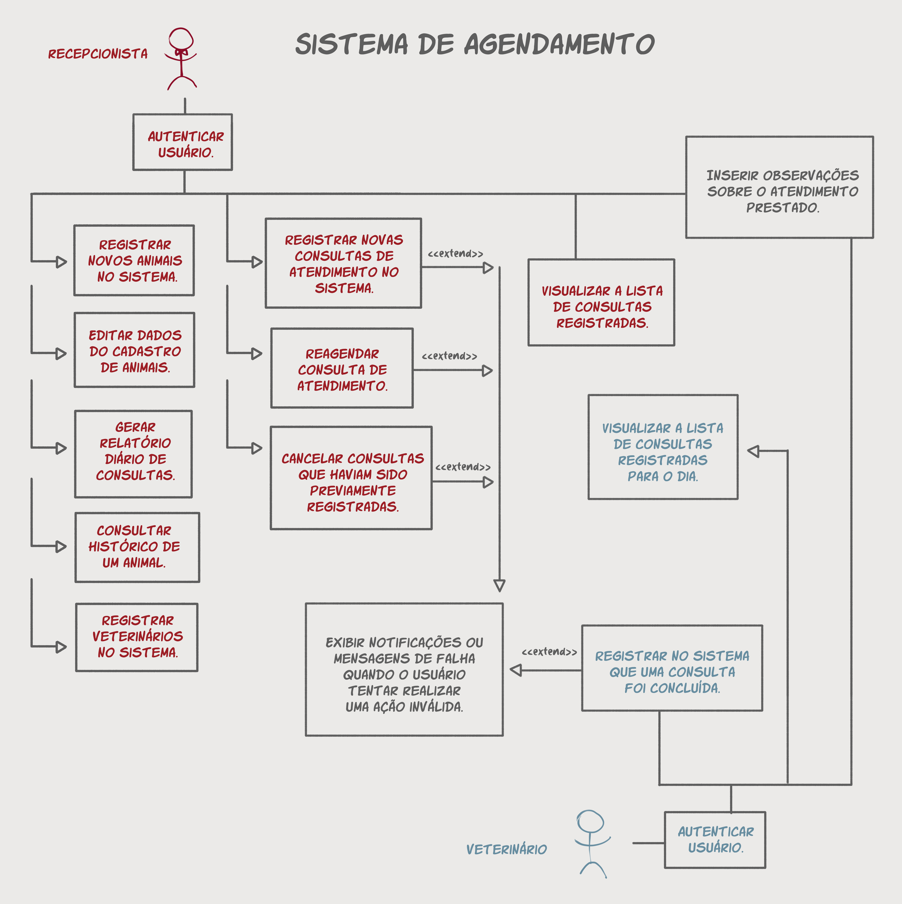

# Especificações do Sistema

## Contexto fornecido pelo TP

### Sistema de Agendamento da Clínica Veterinária VidaPet

A VidaPet é uma clínica veterinária pequena que atende cães e gatos. Hoje a agenda fica num caderno na recepção, o que causa horários marcados em duplicidade e consultas esquecidas. O sistema deve organizar o cadastro dos animais e a agenda de consultas dos veterinários.

### Entidades principais

- **Animal**: nome, espécie (cão ou gato), idade, nome do tutor e telefone do tutor.
- **Veterinário**: nome e CRMV.
- **Consulta**: animal, veterinário, data, horário, situação (agendada, realizada ou cancelada) e observações.

### Atores

- **Recepcionista**: cadastra animais e veterinários, agenda e cancela consultas.
- **Veterinário**: consulta sua agenda do dia e registra a consulta como realizada, com as observações do atendimento.

### Regras de negócio

1. As consultas duram 30 minutos e só podem ser marcadas de segunda a sexta, das 8h às 18h.
2. Um veterinário não pode ter duas consultas agendadas no mesmo horário.
3. Não é possível agendar consultas em datas que já passaram.
4. Uma consulta só pode ser cancelada se ainda estiver como agendada.
5. Somente consultas agendadas podem ser marcadas como realizadas, e apenas pelo veterinário da consulta.

## 1. Levante os requisitos do sistema especificado

> Requisitos marcados com `*` foram sugestões pedidas para I.A. com a intenção de melhorar a qualidade do projeto.
>
> Modelo usado: `gemini-3.1-pro-preview`

### Requisitos Funcionais

- **RF01\***: Autenticar usuário.
- **RF02**: Registrar novos animais no sistema.
- **RF03\***: Editar dados do cadastro de animais.
- **RF04**: Registrar veterinários no sistema.
- **RF05**: Registrar novas consultas de atendimento no sistema.
- **RF06\***: Reagendar consulta de atendimento.
- **RF07**: Visualizar a lista de consultas registradas.
- **RF08**: Registrar no sistema que uma consulta foi concluída.
- **RF09\***: Gerar relatório diário de consultas.
- **RF10\***: Consultar histórico de um animal.
- **RF11**: Inserir observações sobre o atendimento prestado.
- **RF12**: Cancelar consultas que haviam sido previamente registradas.
- **RF13**: Exibir notificações ou mensagens de falha quando o usuário tentar realizar uma ação inválida.

### Requisitos Não Funcionais

- **RNF01**: O sistema deve aceitar exclusivamente as opções "cão" ou "gato" no campo de espécie do animal.
- **RNF02**: O sistema deve aceitar exclusivamente as opções "agendada", "realizada" ou "cancelada" no campo de situação da consulta.
- **RNF03**: A criação de perfis para novos animais é uma permissão exclusiva do recepcionista.
- **RNF04\***: A edição de dados do cadastro de animais é uma permissão exclusiva do recepcionista.
- **RNF05**: A inclusão de novos veterinários é uma permissão exclusiva do recepcionista.
- **RNF06**: O registro de consultas de atendimento é uma permissão exclusiva do recepcionista.
- **RNF07**: O sistema deve aceitar exclusivamente registrar consultas de atendimentos em datas e horários futuros, limitando-se aos dias úteis (segunda a sexta-feira) e a registrar consultas dentro do intervalo das 08:00 às 18:00.
- **RNF08**: O sistema deve aceitar exclusivamente registrar consultas de atendimentos com blocos de tempo de no mínimo meia hora para cada consulta, impedindo sobreposições na agenda do veterinário.
- **RNF09\***: O sistema deve realizar um backup automático e diário de todo o banco de dados sempre às 20h, garantindo a recuperação dos dados em caso de falha.
- **RNF10\***: O reagendamento de consultas de atendimento é uma permissão exclusiva do recepcionista.
- **RNF11\***: A geração de relatório de consultas é uma permissão exclusiva do recepcionista.
- **RNF12\***: A consulta ao histórico de um animal é uma permissão exclusiva do recepcionista.
- **RNF13**: A mudança de status de uma consulta para "realizada" só pode ser feita pelo próprio médico veterinário responsável por aquele horário.
- **RNF14**: O sistema deve aceitar exclusivamente registrar que uma consulta foi concluída apenas consultas que possuam o status de "agendada".
- **RNF15**: A confirmação de conclusão da consulta exige obrigatoriamente o preenchimento das observações e vice-versa, não sendo possível salvar um sem o outro.
- **RNF16**: A visualização da lista de consultas registradas pelo veterinário é limitada exclusivamente aos compromissos da data atual.
- **RNF17**: O cancelamento de consultas de atendimento é uma permissão exclusiva do recepcionista.
- **RNF18**: O sistema deve aceitar exclusivamente cancelar apenas consultas de atendimentos que possuam o status de "agendada".
- **RNF19\***: O sistema deve manter um registro de todas as ações dos usuários, gravando a data, a hora e qual usuário realizou a ação, para fins de auditoria.
- **RNF20\***: A interface do sistema deve ser responsiva, permitindo que os veterinários acessem e preencham as observações das consultas confortavelmente através de tablets ou smartphones dentro dos consultórios, além do uso em computadores desktop na recepção.
- **RNF21\***: O sistema deve ser uma aplicação web compatível com as versões mais recentes dos principais navegadores do mercado (Google Chrome, Mozilla Firefox, Safari e Microsoft Edge).

## 2. Especifique os casos de uso em UML

## 5. Justifique o escopo definido para esta entrega

### Priorizando com MoSCoW

Cada categoria de prioridade do MoSCoW está definida, com sua respectiva justificativa de escopo.

#### Must

- **RF05**: Resolve a dor principal do usuário
- **RF07**: Resolve a dor principal do usuário
- **RF02**: RF05 depende dele
- **RF04**: RF05 depende dele
- **RNF07**: Se der errado, o prejuízo é grande
- **RNF08**: Se der errado, o prejuízo é grande

#### Should

- **RF12**: Importante, mas dá para esperar
- **RF13**: Importante, mas dá para esperar
- **RNF18**: Importante, mas dá para esperar

#### Could

- **RF03**: Seria bom, se sobrar tempo
- **RF08**: Seria bom, se sobrar tempo
- **RF11**: Seria bom, se sobrar tempo
- **RNF14**: Seria bom, se sobrar tempo

#### Won't

- **RF01**: Não cabe no tempo que temos
- **RF06**: Não cabe no tempo que temos
- **RF09**: Não cabe no tempo que temos
- **RF10**: Não cabe no tempo que temos
- **RNF01**: Não cabe no tempo que temos
- **RNF02**: Não cabe no tempo que temos
- **RNF03**: Não cabe no tempo que temos
- **RNF04**: Não cabe no tempo que temos
- **RNF05**: Não cabe no tempo que temos
- **RNF06**: Não cabe no tempo que temos
- **RNF09**: Não cabe no tempo que temos
- **RNF10**: Não cabe no tempo que temos
- **RNF11**: Não cabe no tempo que temos
- **RNF12**: Não cabe no tempo que temos
- **RNF13**: Não cabe no tempo que temos
- **RNF15**: Não cabe no tempo que temos
- **RNF16**: Não cabe no tempo que temos
- **RNF17**: Não cabe no tempo que temos
- **RNF19**: Não cabe no tempo que temos
- **RNF20**: Não cabe no tempo que temos
- **RNF21**: Não cabe no tempo que temos

### Suposições

- RF13 ficou implícito pela necessidade de fluxos alternativos no UML.
- Implícitas pela atuação de cada ator fornecida pelo TP:
  - RNF03
  - RNF04
  - RNF05
  - RNF06
  - RNF10
  - RNF11
  - RNF12
  - RNF13
  - RNF16
  - RNF17
- RNF08 foi implícito com o conhecimento sobre a duração das consultas.
- RNF15 foi interpretado pela forma como o registro de consulta como realizada foi descrito como feito pelo Veterinário nas regras de negócio.

Demais foram explícitas pelo enunciado ou sugeridas pela I.A. com a intenção de melhorar a qualidade do projeto, conforme indicado.

## Link para o repositório GitHub

> https://github.com/GBelloS/InfnetBloco3-SistemaAgendamento
